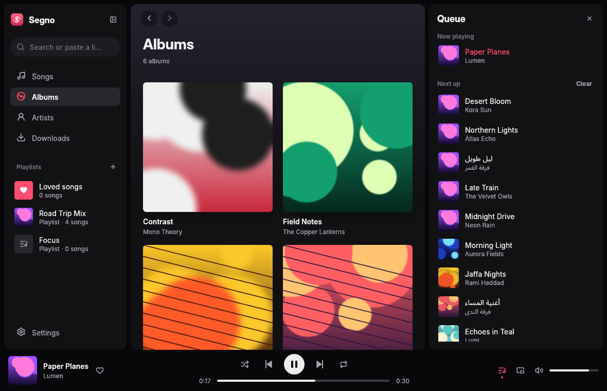

<p align="center"></p>

<h1 align="center">Segno</h1>

<p align="center">A light, modern music player for Windows. Plays your own music, suggests new songs, and downloads from YouTube, SoundCloud and many other sites.</p>

<p align="center"><a href="https://github.com/ferasbusiness666/segno/releases/latest"><b>Download Segno for Windows</b></a></p>



## Download

Get **Segno.exe** from the [latest release](https://github.com/ferasbusiness666/segno/releases/latest) and run it. No installer needed.

Windows may say "Windows protected your PC" because Segno is new and unsigned. Click **More info**, then **Run anyway**.

Segno updates itself, so you only download it once.

## What it does

- Plays everything in your music folder (MP3, M4A/AAC, ALAC, FLAC, OGG, WAV, AIFF), including subfolders.
- Finds new files by itself: Windows tells it when the folder changes, no polling.
- Songs, Albums, Artists, Loved songs and your own playlists. Drag songs onto a playlist to add them, drag them inside it to reorder.
- Drag songs in the Songs list to put them in your own order.
- Shuffle, repeat (off / all / one), "Play next" and "Add to queue".
- A queue you can drag to reorder, remove songs from, and add to (drag songs onto it, or use **+** to find songs in your library).
- When the queue ends, it keeps playing from your library (you can turn this off in Settings).
- Drag the edges of the sidebar and the queue to resize them. Drag the sidebar small, or press Ctrl + B, to fold it into icons.
- Now Playing: the record slides out of its sleeve and spins while the song plays, with Up next beside it.
  Press **F11** (or the full screen button) for a full-screen view over a blurred copy of the cover.
- **For you**: new songs picked from what you've been playing lately. Listen right away, download what you like.
- Give any playlist your own picture (right-click it, or click its cover).
- Mini player (always on top), media keys and the Windows media overlay.
- Keeps playing from the tray when you close the window while music is playing.
- Remembers your song, position, queue, volume and window size.

## YouTube and other sites

Type in the search box: matches from your library show up right away, and Enter searches YouTube.
Paste a link and it shows up too: YouTube, SoundCloud, Bandcamp and the other sites
[yt-dlp supports](https://github.com/yt-dlp/yt-dlp/blob/master/supportedsites.md).
Click a result to listen to it, or press the download button to keep it.

- Songs are saved into your music folder as "Artist - Title" (M4A from YouTube; MP3, M4A, FLAC or Ogg from other sites), with title, artist and cover art written in.
- Paste a playlist link and press **Save playlist**: it shows up in your sidebar with its own cover and fills in as the songs download.
- **Spotify** links work too (songs, albums and playlists). Spotify's audio is locked, so Segno reads the song names
  and downloads each one from YouTube. Now and then it picks a different version of a song.
- The Downloads list is kept between restarts, and unfinished downloads pick up where they left off.
- [yt-dlp](https://github.com/yt-dlp/yt-dlp) is downloaded on first use and keeps itself updated.
  YouTube needs a JavaScript runtime: Segno uses Node, Deno or Bun if you have one, otherwise it fetches Deno once.
- All of it runs hidden, with no console windows.

Only download music you have the right to.

## Light on your battery

- Nothing is drawn while you're not using the window.
- While music plays it redraws once per second (for the clock and seek bar). Minimized or hidden, not at all.
- The spinning record on Now Playing redraws about 30 times a second, only while that screen is open. You can turn the spinning off in Settings.
- Audio runs on its own thread, and the sound device is let go after 20 seconds of pause.
- About 150 ms of audio is queued ahead, so a busy moment (like switching desktops on a slow laptop) doesn't make the music skip.
- Covers are shrunk once and cached on disk; only the covers on screen are kept in memory.

## Keyboard

| Keys | Does |
| --- | --- |
| Space | Play / pause |
| Ctrl + → / ← | Next / previous |
| Ctrl + ↑ / ↓ | Volume |
| Ctrl + F | Search |
| Ctrl + M | Mini player |
| Ctrl + B | Fold or unfold the sidebar |
| F11 | Full-screen Now Playing (Esc to leave) |
| Alt + ← | Back |

## Where things are stored

- Settings, playlists, download history and what you played (for For you): `%APPDATA%\Segno`
- Library index, cover cache, yt-dlp: `%LOCALAPPDATA%\Segno`
- If something crashes, details go to `%LOCALAPPDATA%\Segno\crash.log`

Segno doesn't collect or send anything about you. The only things it connects to are YouTube and the sites you paste links from (when you search, download or open For you), GitHub (to check for updates) and the yt-dlp and Deno downloads.

## Build it yourself

On Windows with [Rust](https://rustup.rs) installed:

```
cargo build --release
```

The exe ends up in `target\release\segno.exe`.

## Publishing a new version

GitHub builds the exe for you:

1. Raise `version` in `Cargo.toml` (for example `1.0.0` → `1.0.1`) and push.
2. On GitHub, open **Actions → Build → Run workflow**, tick **Publish a release**, and press **Run workflow**.
3. In about 10 minutes the release is up with `Segno.exe` attached. Everyone's Segno picks it up within a few hours.

Pushing a tag like `v1.0.1` does the same thing.

## Credits

- UI: [egui](https://github.com/emilk/egui), audio: [rodio](https://github.com/RustAudio/rodio) and [Symphonia](https://github.com/pdeljanov/Symphonia), tags: [lofty](https://github.com/Serial-ATA/lofty-rs)
- Icons: [Lucide](https://lucide.dev) (ISC license, see `assets/LUCIDE-LICENSE.txt`)
- Font: [Inter](https://rsms.me/inter/) (SIL Open Font License, see `assets/INTER-LICENSE.txt`)
- Downloads: [yt-dlp](https://github.com/yt-dlp/yt-dlp) (fetched when needed, not bundled)

## License

[MIT](LICENSE)
